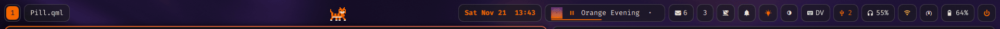
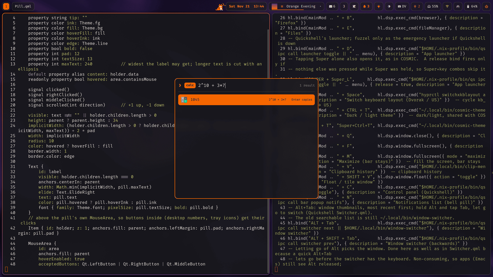
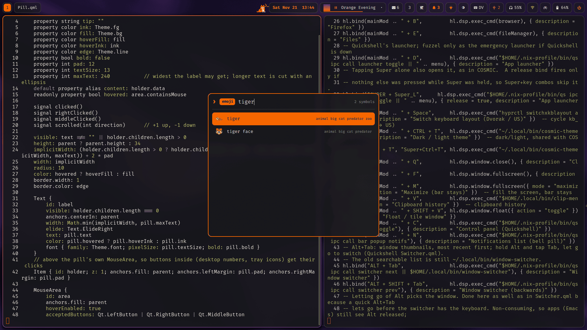
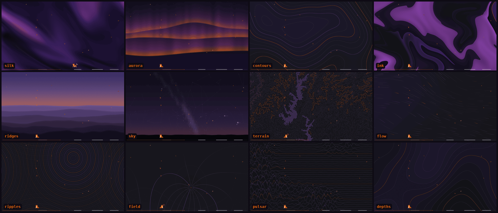
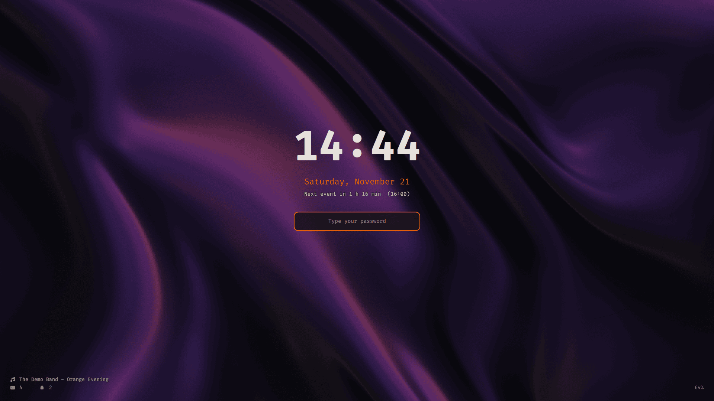
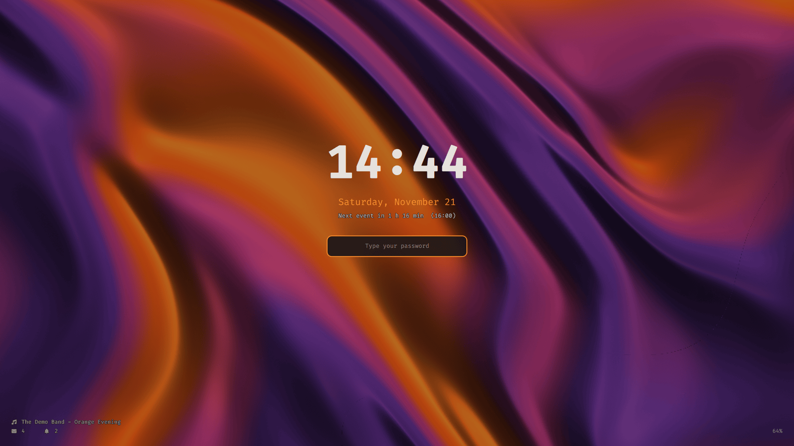
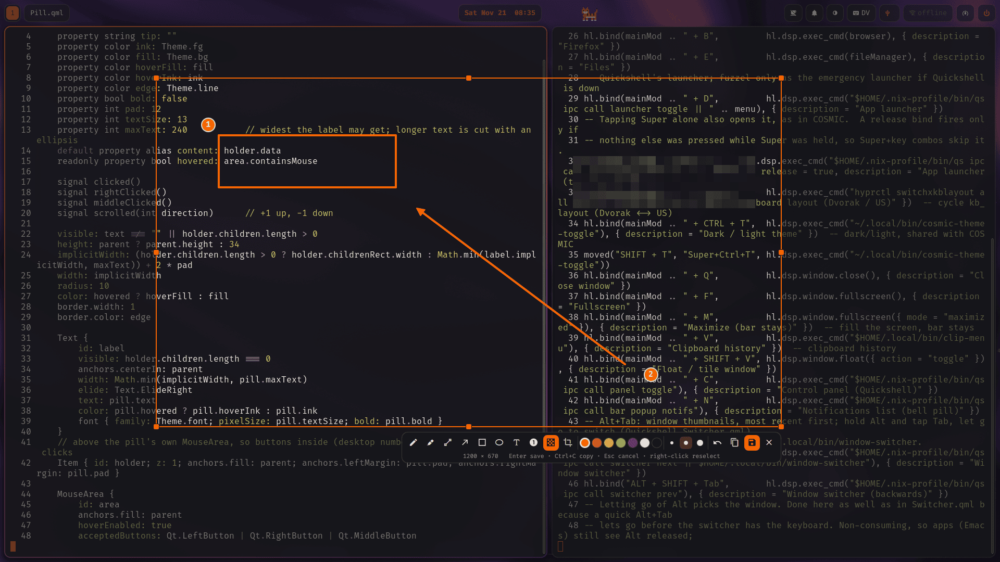
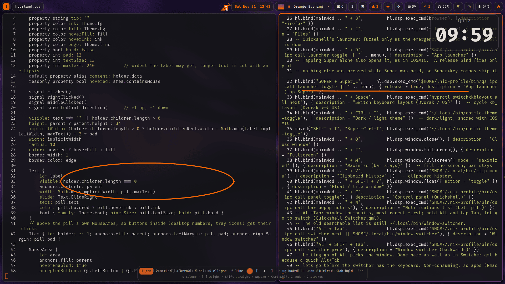
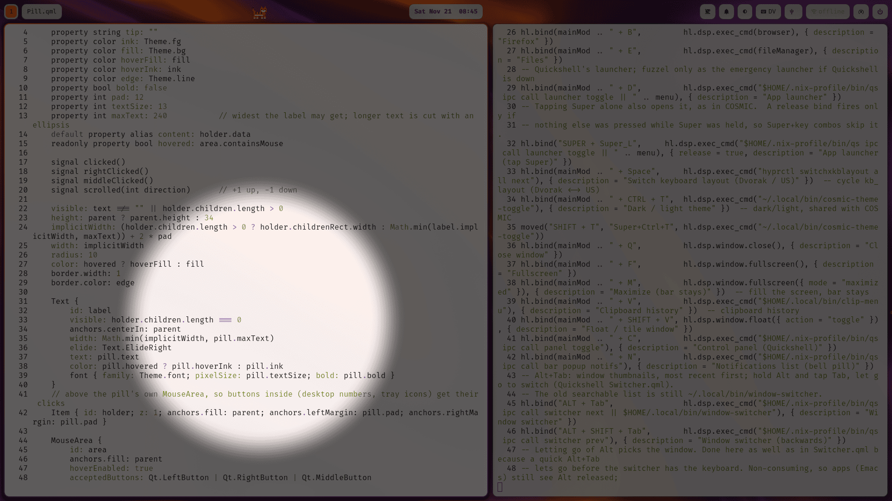
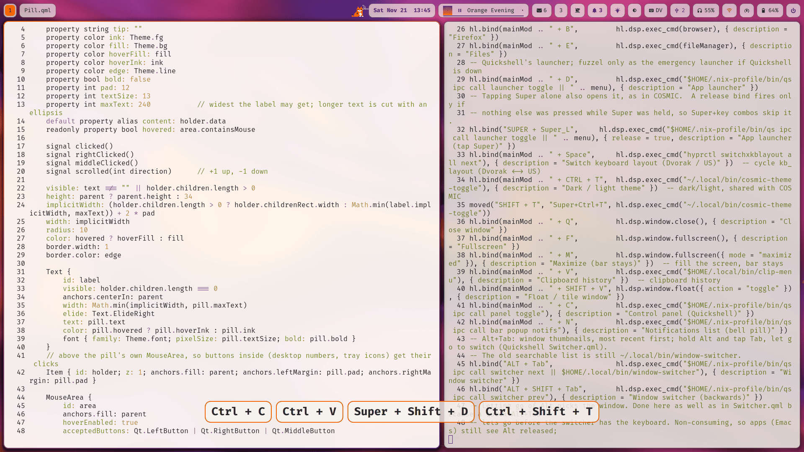

#+title: The shell

Everything you see that is not a window is Quickshell: =home/.config/quickshell/=. =shell.qml= is the entry point and =quickshell-start= launches it (through nixGL, since Quickshell comes from Nix). The lock screen (=lockscreen.qml=) and the polkit password prompt (=authprompt.qml=) run as their own Quickshell instances, so a crash in the main shell cannot take them down.

Most pieces can be driven from a terminal with =qs ipc call TARGET FUNCTION=; =qs ipc show= lists them all (launcher, panel, dashboard, overview, settings, notif, island, wallpaper, lecture, pet, lights, ...).

* Bar

=Bar.qml=, one per screen. Left: the desktops and the focused window's title. Centre: the clock, with the music pill hanging off its right side and shortening itself to the room left. Right: the pills. A narrow screen (under 1400 px, like a portrait monitor) gets fewer of them.

Every pill follows one rule (=Pill.qml=):

| Button | Does |
|--------+------|
| click | opens its list or card when it has one, otherwise does its one thing |
| right-click | the quick action: mute, Do Not Disturb, play/pause, eject, reconnect, next power profile, charge cap on/off; or its settings when it has none |
| middle-click | the full app (the mixer, the music player, ...) where there is one |
| scroll | only where it changes a level: desktops and volume |

Nothing that cuts something off (eject, reconnect) sits on a plain click.

The pills, roughly right to left: power menu, battery, power profile, network, microphone, sound, drives, Bluetooth, keyboard layout, theme, lights, notifications, keep-awake, Tailscale, Teams and mail counts, the Org clock, what is using the mic or camera, and recording. Pills with nothing to say hide.

** Health pill

=HealthPill.qml=, =Health.qml=, =HealthList.qml=, =shell-health=. Answers "is every background job on this laptop still working?" (mail sync, calendar pulls, backups, the services under =systemd/user=). Hidden while everything works. Stale is amber text, failing is a red fill, hovering lists what is wrong, and a click opens the list. It tries hard not to cry wolf: a job is only raised once it has been wrong for about two minutes, network jobs get a grace period while offline and for five minutes after a wake, a service that is restarting itself shows as a quiet "↻ n" rather than a failure, an unknown state is never shown as fine, and from Settings > Health a job can be ignored until it recovers or not watched at all. Notices (updates waiting, a restart needed, low disk) never colour it.

** Lights pill

=Lights.qml=, =LightsList.qml=, =gvm=, =gvm-gui=. Two Bluetooth LED video lights for calls and recordings. Click for the list (each light, presets), right-click toggles them, middle-click opens the full window. Nothing polls the lights, since asking a light means connecting to it and taking it from the phone app; the pill shows the last state the tools wrote. It hides when no lights are configured.

** Island

=Island.qml=. A short message that grows out of the top of the bar over the clock and folds back: a meeting in five minutes, recording started, headphones connected, the charger or keyboard layout changed. Scripts can use it: =qs ipc call island say "Title" "second line"=.

#+HTML: 

* Launcher

=Launcher.qml=, =LaunchView.qml=; Super+D (or tap Super). Apps sorted by how often you open them. A prefix switches mode, and the modes are listed under the search line:

| Prefix | Mode |
|--------+------|
| ~=~ | calculator |
| ~:~ | emoji |
| ~v~ | clipboard history |
| ~w~ | open windows |
| ~/~ | files |
| ~?~ | key bindings |
| ~o~ | Org headings |
| ~m~ | mail |
| ~n~ | notes |
| ~t~ | browser tabs |
| ~qr~ | QR code of the text |
| ~event~ | quick calendar event: "event Lunch tomorrow 12-1" |

Tab moves to the next mode.

| Calculator | Emoji |
|------------+-------|
|  |  |

* Notifications

=Notif*.qml=, =Island.qml=. Quickshell is the notification daemon. Popups stack in the top-right corner; repeats collapse into one card with a count; Super+N opens the recent list. Per-app rules (normal, quiet, mute) live in Settings > Notifications.

Calendar-aware Do Not Disturb (=Quiet*.qml=, =quiet.js=) goes quiet during meetings and lectures by itself and says so on the island.

* Control panel and settings

The control panel (=Panel.qml=, Super+C) is the quick stuff: volume, brightness, theme, notifications, keep-awake, sounds, Wi-Fi, power profile, charge limit, night light, Tailscale, focus profiles and the lecture tools.

Settings (=Settings.qml= and its =Settings*.qml= pages, Super+comma) is one window over everything that already exists: appearance, bar, notifications, quiet hours, clocks, screensaver, lecture tools, recording, pet, launcher, power, displays, input, health, session, focus profiles. Every row reads the live value and writes it back where it really lives (the Hyprland config, hypridle, the systemd unit, the app's own file); the settings window keeps no copy of its own.

* Dashboard

=Dashboard.qml=, Super+I; data from =dashboard-data=. The time and next event, today's and tomorrow's calendar, the weather with a four-day forecast, unread mail counts, CPU/memory/temperature/disks, recent notifications and the pet's card. Nothing runs while it is closed.

* Overview and window switcher

=Overview.qml= (Super+Tab) shows every desktop as a card with a live miniature of each screen and its windows. Click a window to go to it, a card to go to that desktop; number keys jump. =Switcher.qml= is Alt+Tab with thumbnails, most recent first.

* Wallpaper

=Wallpaper.qml=, =Wall*.qml=, =shaders/=. Animated shader scenes on the bottom layer (silk, aurora, contours, ink, ridges, terrain, flow, ripples, field, pulsar, depths, and a real night sky), picked from Super+W or Settings > Appearance. The sky is computed for your latitude: star catalogue, constellation lines, moon phase, planets. Seasonal touches (falling leaves, snow, fireflies), weather effects, and a thin band along the bottom showing the day's calendar. On battery it holds still.

The scenes drift slowly; sped up five times:

#+HTML: 

* Lock screen and screensaver

=lockscreen.qml=, =Lock*.qml=; =Saver*.qml=. The lock screen shows the time, the next event and the pet; the screensaver is the wallpaper scene with a clock, after the idle time set in Settings > Screensaver and idle. The lock screen shows a still frame of the current wallpaper scene.

| Dark | Light |
|------+-------|
|  |  |

* Screenshots and recording

=Shot*.qml=: Print freezes every screen, you pick a region (or W for the window under the pointer), mark it up, then copy or save. Each tool has a key: P pen, M marker, L line, A arrow, B box, E ellipse, T text, N numbered steps, X pixelate, C crop; Ctrl+Z undoes.

 =SharePick.qml= is the screen-share picker for =xdg-desktop-portal-hyprland=. =screen-record= records a region or a screen with sound and an optional round webcam bubble (=CamBubble.qml=).

* Lecture tools

=Lecture*.qml=, =Ink.qml=. For teaching from the laptop: draw on the screen (D), a spotlight that dims everything but the pointer (L), show the keys being pressed (K), zoom, and a countdown timer. Super+Z then a letter; Super+Z twice for the menu. In draw mode the toolbar along the bottom lists the pen, marker, arrow, box, ellipse and line, with number keys to switch.

* The pet

=Pet*.qml=. A pixel-art tiger cub that lives in the empty stretches of the bar, or down on the wallpaper when a desktop is empty. It reacts to notifications, sits on the clock, runs a focus timer, keeps reminders and reminds you of the next meeting. Right-click it for its menu. It also has a few secrets.

#+HTML: 
