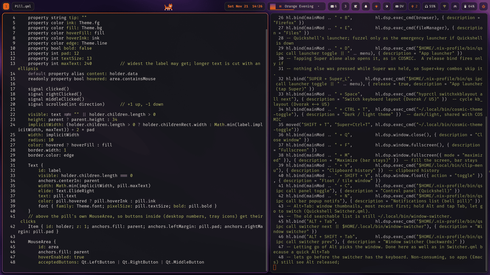
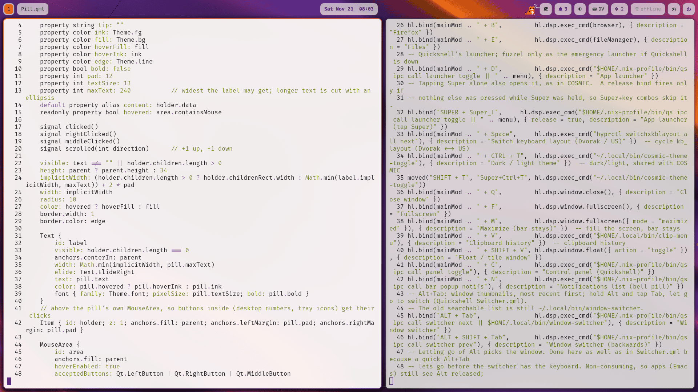

#+title: Theming

| Dark | Light |
|------+-------|
|  |  |

* One palette

Everything is themed from one palette: Clemson orange (=#F56600=) and regalia purple, with dark and light variants. The shell reads its colours from =Theme.qml=; the terminal, GTK, Qt, fuzzel and btop have their own files with the same colours.

* Dark and light by time of day

The switch is one file, =~/.config/cosmic/com.system76.CosmicTheme.Mode/v1/is_dark= (=true= or =false=). COSMIC uses it too, so both sessions agree. Everything follows it:

- Quickshell watches the file (=Theme.qml=) and changes at once.
- Ghostty has =theme = light:Clemson Light,dark:Clemson Dark= and flips with the portal colour scheme.
- =hypr-theme-apply= and =gtk-theme-follows-cosmic= swap the files that need swapping: fuzzel's colours, the GTK accent CSS, the qt5ct/qt6ct colour scheme, Papirus Dark or Light, btop's theme.
- =wallpaper-follows-theme= changes the plain fallback wallpaper for when Quickshell is not running.

=theme-by-time= (run by =theme-by-time.timer=) switches on the night light's schedule in =hyprsunset.conf=: the =identity= profile time starts the light period, the =temperature= profile time starts the dark one. A manual switch (Super+Ctrl+T, the ◐ pill, or the control panel) holds until the next boundary.

* Recolouring everything: palette

=palette= changes the colours of the whole set in one go.

| Command | Does |
|---------+------|
| =palette list= | the plans there are |
| =palette status= | which plan is live and which files it manages |
| =palette new NAME --seed '#hex'= | a plan from one colour (=--alt=, =--scheme= to choose the second) |
| =palette new NAME --image FILE= | a plan from a picture's colours |
| =palette preview NAME= | draws it beside the current one |
| =palette use NAME= | rewrites every themed file from its master copy (=--dry-run= to see first) |
| =palette restore= | back to the Clemson colours |
| =palette follow= =scene=, =time= or =off= | pick the plan by itself, from the wallpaper scene or the time of day |

=home/.config/palette/masters/= holds a master copy of every themed file in the Clemson colours, and =files.json= lists them. A plan is two colours, one standing in for Clemson orange and one for regalia purple. Using it turns orange-family colours to the first's hue and purple-family colours to the second's, keeping every colour's brightness, so text contrast stays what it was by hand. Status colours (red, green, amber) and the terminal's ANSI colours are left alone. =forest=, =ocean= and =rose= are example plans in =plans/=. Settings > Appearance has the same choices.
